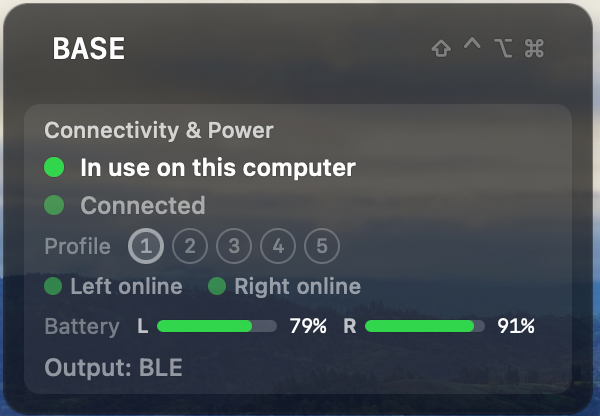
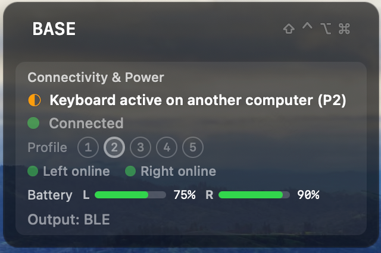
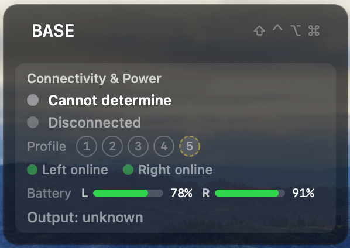
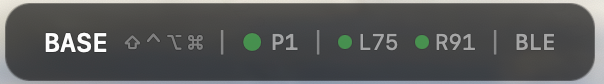
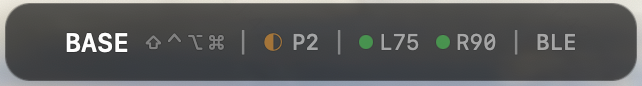
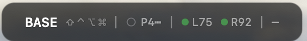
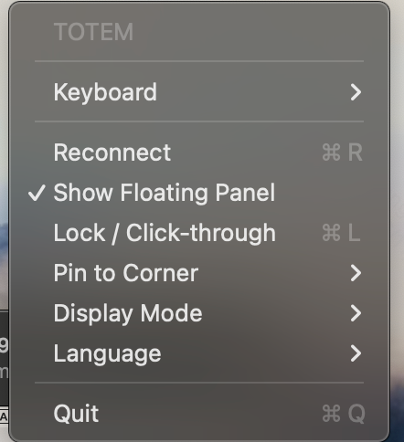

# KeyBeacon

**English** · [中文](README.zh-CN.md) · [**Website** ↗](https://ykiewang.github.io/keybeacon/)

**KeyBeacon** is built for **ZMK** keyboards — above all the screenless wireless splits (the Totem
among them) where there's no on-device way to see what the board is doing. It shows your keyboard's
live internal state — the **active layer**, **held modifiers**, connectivity, and per-half battery —
in a small desktop app, over Bluetooth LE. ZMK is the first-class target: add one entry to
`west.yml`, set one Kconfig symbol, done.

The underlying open **KeyBeacon Protocol (KBP)** is deliberately **not** ZMK-specific, so any
keyboard or firmware that speaks KBP can drive the same app — **ZMK is simply where it works today,
with the least setup**, and the protocol is designed to extend to any keyboard over time.



## Why KeyBeacon

Many ZMK keyboards — the Totem among them — have **no screen**: you press a layer key with no
on-device way to confirm which layer is active. The usual fix is to bolt on hardware (an OLED,
wiring, firmware, cost). KeyBeacon does the opposite — the host your keyboard is already connected
to **has** a screen, so let the software show the state. **No extra hardware, no soldering.** It
starts with layer + modifiers and is built to grow into a general-purpose window into any
keyboard's internal state, over a versioned, extensible protocol.

## Supported ZMK configs

Ready-to-flash ZMK configs with KeyBeacon already wired in:

| Config | Keyboard | Notes |
|--------|----------|-------|
| [`zmk-config-totem`](https://github.com/ykiewang/zmk-config-totem#keybeacon-layer--modifier-status-over-ble) | Totem (38-key screenless split) | The reference integration — start here. |
| [`zmk-config-corne`](https://github.com/YkieWang/zmk-config-corne/tree/feat/keybeacon) | Corne (CRKBD) | Integration lives on the `feat/keybeacon` branch. |

Built KeyBeacon into your own board? **Contributions are welcome** — open an issue or PR on this
repo with your config, and we'll add it to the list.

## Quick start

Grab the latest build from the [**Releases**](https://github.com/ykiewang/keybeacon/releases) page, then:

### macOS

1. Download `BleWidget-<version>.dmg`, open it, and drag **BleWidget.app** to `/Applications`.
2. **First launch:** the build is ad-hoc signed (not notarized), so right-click the app →
   **Open** → confirm once. *(One-time; a future notarized release removes this step.)*
3. Grant **Bluetooth** permission when asked. The app lives in the **menu bar** — connect a
   compatible keyboard and its live layer/modifier status appears.

### Windows

1. Download `KeyBeacon-win-x64-<version>.zip` (or `-win-arm64-`), unzip, and run `KeyBeacon.exe`.
   It's **self-contained** — no .NET install needed.
2. **First run:** SmartScreen may warn → **More info** → **Run anyway**. If the file is blocked,
   right-click it → **Properties** → tick **Unblock**.
3. The app lives in the **system tray** (the **K** icon, possibly under the `^` overflow). Left-click
   toggles the floating panel; right-click opens the menu.

> **Requirements:** macOS 12 (Monterey)+ or Windows 10 (build 19041 / 2004) / 11, plus a keyboard
> that implements KBP on its host-link BLE role (see [`conformance/`](conformance/)). Both apps are
> bilingual (中文 / English), switchable anytime from the app menu.

## Screenshots

The floating panel updates as you type. A **per-link host indicator** (new in KBP 1.2) tells
*this* computer whether the keyboard is typing here (green ●), active on another paired computer
(orange ◐), or disconnected from this host (grey ○).

<details>
<summary><b>More screenshots</b> — full states, compact mode, menu bar</summary>

### Full display mode

| In use on **this** computer | Active on **another** computer | Link to this host down |
|:---:|:---:|:---:|
|  |  |  |

### Compact display mode

The same state folded into one menu-bar-width strip — layer · modifiers · host · profile ·
per-half battery · output:

| Host state | |
|:---|:---|
| **In use here** — green `● P1` |  |
| **Active elsewhere** — orange `◐ P2` |  |
| **Link down** — grey `○ P4` |  |

### Menu bar

Reconnect, toggle the floating panel, lock / click-through, pin to a corner, switch display mode,
or change language:



</details>

## What's in this repo

| Directory | What |
|-----------|------|
| [`app/macos/`](app/macos/) | The macOS app (menu-bar widget + floating status panel). |
| [`app/windows/`](app/windows/) | The Windows app (system tray + floating status panel). |
| [`protocol/`](protocol/) | The authoritative, versioned **KeyBeacon Protocol** (KBP) standard. |
| [`conformance/`](conformance/) | The **conformance kit** — guide + checklist + self-test tool for keyboard authors. |

> **Platforms:** macOS and Windows are available now; **Linux is planned.** The protocol is
> OS-neutral by design.

## For keyboard authors

- **Running ZMK?** Don't implement KBP by hand — add the
  [`zmk-keybeacon`](https://github.com/ykiewang/zmk-keybeacon) Zephyr module to your
  `config/west.yml` and set `CONFIG_ZMK_KEYBEACON=y` on the central build. Two-step setup in its
  [GETTING-STARTED.md](https://github.com/ykiewang/zmk-keybeacon/blob/main/GETTING-STARTED.md).
- **Want a working example?** [`zmk-config-totem`](https://github.com/ykiewang/zmk-config-totem)
  wires KeyBeacon into a split keyboard end to end — flash it, or read it to see exactly how the
  module plugs in.
- **Other firmware, or from scratch?** Read [`protocol/README.md`](protocol/README.md) (the
  standard) and [`conformance/CONFORMANCE.md`](conformance/CONFORMANCE.md) (what to implement),
  then run the self-test: `python3 conformance/conformance_tool.py`.

## Roadmap

Candidate metrics for a screenless split keyboard — connectivity & power (shipped in KBP 1.1 / 1.2),
input & lock state, typing stats, and device health. See [**docs/ROADMAP.md**](docs/ROADMAP.md).

## Build from source (optional)

```bash
cd app/macos
swift build -c release        # or: swift run BleWidget
swift test                    # pure-logic unit tests
```

Package a distributable bundle: `./packaging/make-app.sh 0.0.0-dev` →
`dist/BleWidget.app`, `.dmg`, `.zip`, `.sha256`.

## License

MIT — see [LICENSE](LICENSE). The protocol is permissively licensed so any keyboard or app may
implement it.
