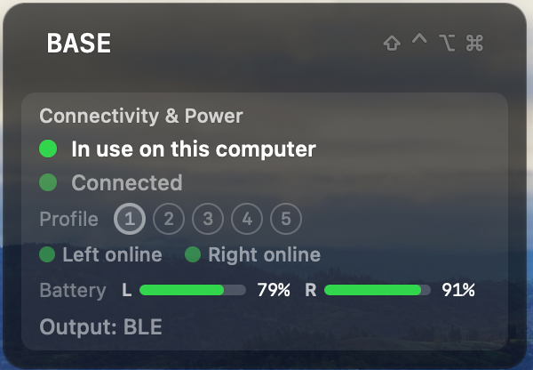
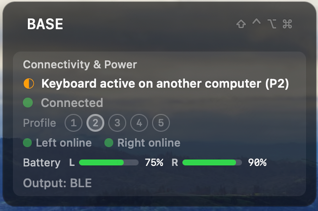
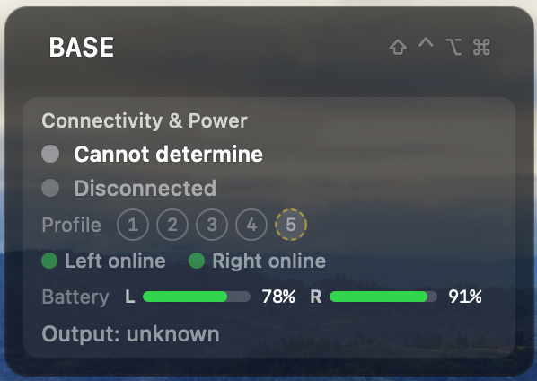
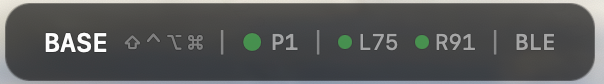
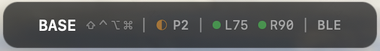
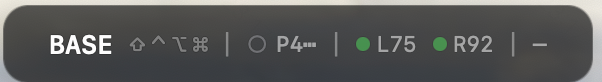
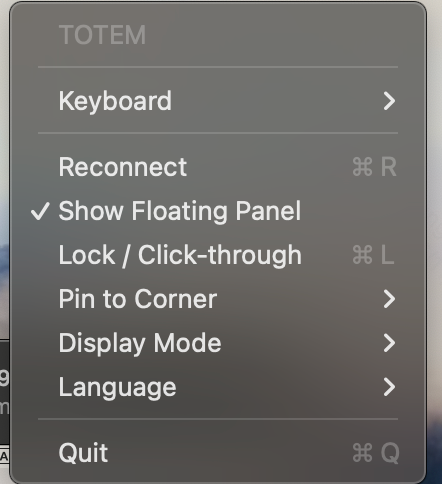

# KeyBeacon

[English](README.md) · **中文** · [**网站** ↗](https://ykiewang.github.io/keybeacon/)

**KeyBeacon** 在一个小巧的桌面应用里,通过蓝牙 LE 实时显示键盘的内部状态 —— **当前层**与**按住
的修饰键**。它适用于任何实现了开放 **KeyBeacon 协议(KBP)** 的键盘,而不限某一品牌或型号。



## 快速上手

从 [**Releases**](https://github.com/ykiewang/keybeacon/releases) 页面下载最新构建,然后:

### macOS

1. 下载 `BleWidget-<版本>.dmg`,打开后把 **BleWidget.app** 拖到「应用程序」。
2. **首次启动:** 当前构建为 ad-hoc 签名(未公证),右键点应用 → **打开** → 确认一次即可。
   *(仅首次;将来的公证版本会移除这一步。)*
3. 按提示授予**蓝牙**权限。应用常驻**菜单栏** —— 连接一把兼容键盘,其实时的层/修饰键状态即会显示。

### Windows

1. 下载 `KeyBeacon-win-x64-<版本>.zip`(ARM64 机器选 `-win-arm64-`),解压后运行 `KeyBeacon.exe`。
   该构建为**自包含单文件** —— 无需安装 .NET。
2. **首次运行:** SmartScreen 可能告警 → **更多信息** → **仍要运行**。若文件被阻止,右键 →
   **属性** → 勾选**解除锁定**。
3. 应用常驻**系统托盘**(**K** 图标,可能收在 `^` 溢出箭头里)。左键切换悬浮面板,右键打开菜单。

> **环境要求:** macOS 12(Monterey)或更高,或 Windows 10(build 19041 / 2004)/ 11;以及一把在其
> 宿主链路(central)BLE 角色上实现了 KBP 的键盘(见 [`conformance/`](conformance/))。两个客户端
> 均支持双语(中文 / English),可随时在应用菜单切换。

## 界面预览

悬浮面板随你打字实时更新。其中的**每连接主机指示**(KBP 1.2 新增)会告诉*这台*电脑:键盘正在此
打字(绿 ●)、在另一台已配对电脑上活跃(橙 ◐),还是与本机已断开(灰 ○)。

<details>
<summary><b>更多截图</b> —— 完整模式各状态、精简模式、菜单栏</summary>

### 完整模式

| 正在**此**电脑使用 | 在**另一台**电脑使用 | 与本机链路断开 |
|:---:|:---:|:---:|
|  |  |  |

### 精简模式

同一状态折叠进一条菜单栏宽度的横条 —— 层 · 修饰键 · 主机 · profile · 左右半电量 · 输出:

| 主机状态 | |
|:---|:---|
| **本机在用** — 绿 `● P1` |  |
| **他机在用** — 橙 `◐ P2` |  |
| **链路断开** — 灰 `○ P4` |  |

### 菜单栏

重新连接、显示/隐藏悬浮面板、锁定 / 点击穿透、吸附到屏角、切换显示模式、切换语言:



</details>

## 为什么是 KeyBeacon

很多 ZMK 键盘 —— 比如 Totem —— **没有屏幕**:你按下层切换键,却无法在键盘本体上确认当前在哪一层。
常见解法是外挂硬件(一块 OLED、走线、固件、成本)。KeyBeacon 反其道而行 —— 你的键盘本就连着的
那台电脑**有**屏幕,那就用软件来显示状态。**不需要额外硬件、不需要焊接。** 它从"层 + 修饰键"
起步,并被设计为逐步成长为一个通用的键盘内部状态窗口,建立在带版本、可扩展的协议之上。

## 本仓库包含什么

| 目录 | 内容 |
|------|------|
| [`app/macos/`](app/macos/) | macOS 应用(菜单栏小组件 + 悬浮状态面板)。 |
| [`app/windows/`](app/windows/) | Windows 应用(系统托盘 + 悬浮状态面板)。 |
| [`protocol/`](protocol/) | 权威、带版本的 **KeyBeacon 协议**(KBP)标准。 |
| [`conformance/`](conformance/) | **一致性套件** —— 面向键盘作者的指南 + 清单 + 自测工具。 |

> **平台:** macOS 与 Windows 现已可用;**Linux 已在计划中。** 协议在设计上与操作系统无关。

## 面向键盘作者

- **用的是 ZMK?** 无需手写实现 KBP —— 把
  [`zmk-keybeacon`](https://github.com/ykiewang/zmk-keybeacon) Zephyr 模块加入 `config/west.yml`,
  并在 central 构建上设置 `CONFIG_ZMK_KEYBEACON=y`。两步接入详见其
  [GETTING-STARTED.md](https://github.com/ykiewang/zmk-keybeacon/blob/main/GETTING-STARTED.md)。
- **想要可直接运行的示例?** [`zmk-config-totem`](https://github.com/ykiewang/zmk-config-totem)
  把 KeyBeacon 完整接入了一把分体键盘 —— 刷进去即可,或直接阅读它、看模块究竟怎么接入。
- **其他固件,或从零实现?** 阅读 [`protocol/README.md`](protocol/README.md)(标准)与
  [`conformance/CONFORMANCE.md`](conformance/CONFORMANCE.md)(需要实现什么),然后运行自测:
  `python3 conformance/conformance_tool.py`。

## 路线图

面向无屏分体键盘的候选指标 —— 连接与电量(已随 KBP 1.1 / 1.2 发布)、输入与锁定状态、打字统计、
设备健康。见 [**docs/ROADMAP.md**](docs/ROADMAP.md#zh-roadmap)。

## 从源码构建(可选)

```bash
cd app/macos
swift build -c release        # 或:swift run BleWidget
swift test                    # 纯逻辑单元测试
```

本地打包可分发产物:`./packaging/make-app.sh 0.0.0-dev` →
`dist/BleWidget.app`、`.dmg`、`.zip`、`.sha256`。

## 许可

MIT —— 见 [LICENSE](LICENSE)。协议特意采用宽松许可,任何键盘或应用都可实现。
